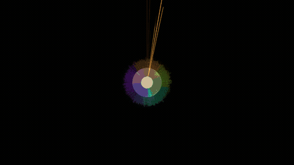
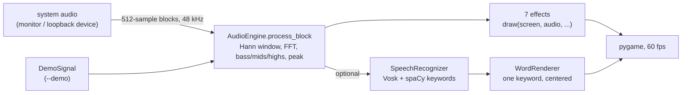

# HYPNOTIC

A fullscreen, low-latency audio visualizer for focused listening. It turns whatever is playing (an audiobook, a lecture, a podcast, music) into one large, slowly evolving pattern, and can optionally show a single spoken keyword at a time. It is aimed at listeners who keep their attention on audio more easily when their eyes have something calm and responsive to rest on, including many people with ADHD.



## Why

Attention to audio-only material can drift when there is nothing to look at, but a busy screen competes with the content. HYPNOTIC aims for the middle: visuals that react to the sound, sit in one place, carry no text by default, and never ask for interaction.

### Research foundation

The design follows findings from research on how learners with ADHD process multimedia:

> *"According to the theory of arousal, the addition of multimedia elements would function as a cue to recapture discontinuous and periodic attention, provoking and maintaining not only attention, but also helping the selection of relevant contents."*
> Antonietti et al., "Multimedia Learning in ADHD Students" (2021)

| Research finding | Design response |
|---|---|
| Learners with ADHD struggle with high-density displays | One keyword at most, centered, in a large font |
| Visuospatial processing is weaker than auditory processing | Audio stays primary; the visuals ask for no reading or decisions |
| Difficulty narrowing attention to a specific region | Keywords always appear in the same place |
| Multimedia helps recapture discontinuous attention | A moving pattern gives wandering eyes somewhere to land |
| Redundant on-screen text (full subtitles) can increase cognitive load | Only extracted keywords, never a full transcript |

**References**
- Brown, V. & Lewis, D. (2012). *Individuals with ADHD and the Cognitive Processing of Multimedia.* Florida Atlantic University / Nova Southeastern University.
- Antonietti, A., Cancer, A., Fabio, R.A., Iannello, P., & Zugno, E. (2021). *Multimedia Learning in ADHD Students.* In B.M. Kyser (Ed.), *Attention-Deficit Hyperactivity Disorder: Diagnosis, Prevalence and Treatment.* Nova Science Publishers.

## Architecture



- **Audio**: `sounddevice` delivers 512-sample blocks at 48 kHz (about 10.7 ms each). Each block is Hann-windowed and transformed with a real FFT; three bands (bass, mids, highs) and an overall energy are computed with no smoothing, so the picture reacts within a block. A peak value with fast decay adds punch on beats.
- **Effects**: seven independent classes share one interface (`draw(screen, audio, W, H, time)`). Each frame fades the previous one slightly, which gives trails without keeping history.
- **Keywords (optional)**: Vosk transcribes the same audio stream offline. spaCy tags nouns and proper nouns, and a scoring heuristic (length, technical suffixes such as -tion, -ology, -ment, proper-noun boost, a filler-word skip list, and recently-shown suppression) keeps one or two words on screen at a time. Without spaCy a suffix-based fallback is used.
- **Study timer**: `T` cycles 45 minutes of visuals and a 15-minute dark break screen.

## Stack

Python 3, NumPy, pygame, sounddevice (PortAudio). Optional: Vosk (offline speech recognition) and spaCy (`en_core_web_sm`). Tests use pytest.

## Effects

| Effect | Technique |
|---|---|
| Radial Burst | FFT magnitudes mapped to polar coordinates |
| Waveform Ring | Raw PCM samples as radial displacement of a circle |
| Frequency Tunnel | Spawned rings with perspective projection |
| Particle Flow | Velocity field driven by band energy |
| Sacred Geometry | Parametric polygons with audio-modulated vertices |
| Liquid Morph | Radius built from angular harmonics 2, 3, 5, 7, 11 and 13, weighted by bass, mids and highs |
| Oscilloscope | Time-domain waveform with amplitude scaling |

## Running locally

```bash
git clone https://github.com/elijahsylar/hypnotic.git
cd hypnotic
python3 -m venv .venv && . .venv/bin/activate
pip install -r requirements.txt

python hypnotic.py --demo          # synthetic signal, no audio setup needed
python hypnotic.py --list          # list input devices
python hypnotic.py                 # default input device
python hypnotic.py <device_number> # a specific device from --list
```

To visualize what you are hearing, the input must be a loopback of your output:

- **Linux (PulseAudio / PipeWire):** pick the device whose name ends in `.monitor` from `--list`, or make it the default source with `pactl set-default-source <your-output>.monitor`.
- **Windows:** enable "Stereo Mix" under Sound settings, Recording, Show Disabled Devices.
- **macOS:** install [BlackHole](https://existential.audio/blackhole/) and route output through a Multi-Output Device.

Other flags: `--windowed`, `--effect N`, and `--record DIR --frames N` (saves frames as PNG; the demo GIF above was made this way with `--demo`).

| Key | Action |
|---|---|
| Left / Right | Switch effect |
| `T` | Study timer (45 min on, 15 min break) |
| `W` | Keyword display (needs Vosk) |
| `F` | Fullscreen / windowed |
| `Esc` | Exit |

### Keyword display (optional)

```bash
pip install -r requirements-speech.txt
python -m spacy download en_core_web_sm
```

Download a Vosk English model from [alphacephei.com/vosk/models](https://alphacephei.com/vosk/models) and extract it to `~/.vosk/model`. The small model (`vosk-model-small-en-us-0.15`, about 40 MB) is fast; the large one (`vosk-model-en-us-0.22`, about 1.8 GB) mishears technical vocabulary far less often.

### Tests

```bash
pip install pytest
python -m pytest -q
```

17 tests cover the block analysis (band placement for low and high tones, clamping, silence, peak decay), the demo signal, keyword selection, colour conversion, argument parsing, and a headless five-frame render. They run without an audio device or a display.

## Project status

A small personal tool, feature-complete for its purpose. Contributions of new effects or accessibility improvements are welcome.

## License

MIT. See [LICENSE](LICENSE).
